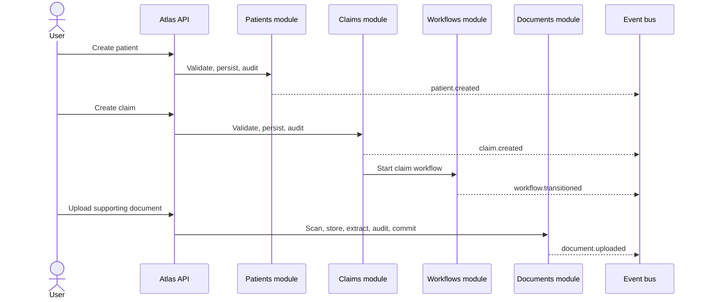
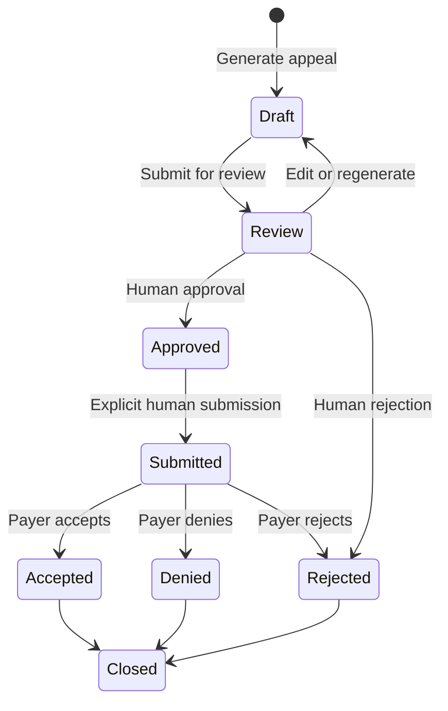
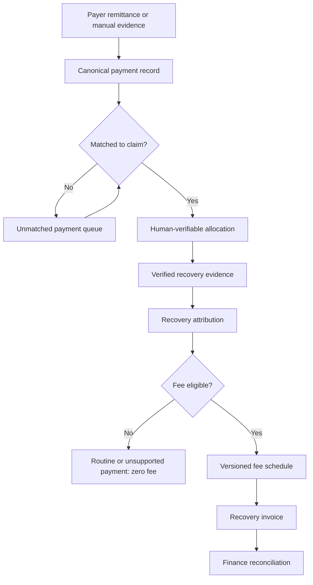

# Atlas End-to-End Project Flow

Last verified: 2026-08-15

## 1. What Atlas Does

Atlas is a Kenya-first, multi-tenant healthcare revenue recovery platform. It
receives claim and supporting evidence from hospitals, validates and analyzes the
claim, guides human recovery work, manages governed appeals and payer submissions,
reconciles payment evidence, and calculates attributable recovery and fees.

Atlas does not replace a hospital information system or payer system. It provides a
controlled recovery workflow around those systems.

## 2. End-to-End Overview

```mermaid
flowchart LR
    A[Hospital source] --> B[Patient and claim intake]
    B --> C[Claim validation]l;ets
    C --> D[Supporting documents]
    D --> E[Recovery and AI analysis]
    E --> F[Human work queue]
    F --> G[Appeal generation]
    G --> H[Human review and approval]
    H --> I[Payer submission]
    I --> J[Payer response]
    J --> K[Payment matching]
    K --> L[Verified recovery]
    L --> M[Attribution and recovery fee]
    M --> N[Finance, analytics, and audit]
```

Every tenant-owned operation derives `organization_id` from authenticated or
trusted task context. Client input does not choose the tenant.

## 3. Intake Paths

Atlas supports two main claim-entry paths.

### Direct User Entry

1. An authenticated user creates or selects a patient.
2. Atlas creates the claim under that patient's organization.
3. Claim rules validate patient, payer, branch, department, currency, amounts, and
   identifiers.
4. Atlas starts the claim workflow and advances a valid new claim from `imported`
   to `validated`.
5. The user uploads supporting documents from Claim detail or the Documents page.

The verified domain-event sequence is:



Each event carries tenant context, an event ID, and a correlation envelope. The
current test proves that these values are present; a single propagated correlation
ID across the entire multi-request business journey remains a release-readiness
gate.

### File or Connector Import

1. A CSV, SFTP, FHIR, X12, or registered connector supplies source data.
2. A source-specific normalizer maps the input to `CanonicalClaim`.
3. The import pipeline validates the file schema and each row.
4. The processor upserts tenant-scoped patient and payer references, then creates
   the claim and related diagnoses, procedure lines, denials, and validation issues.
5. The pipeline publishes `claim.imported`.
6. Registered handlers may enqueue asynchronous analysis through Celery.

`claim.created` and `claim.imported` are intentionally different. Direct API entry
uses `claim.created`; only the ingestion pipeline uses `claim.imported` and its
import-specific consumers.

## 4. Claim and Document Evidence

The Claims module owns claim state, lines, diagnoses, validation, timeline, and
claim-facing APIs. The Documents module owns evidence upload, storage, extraction,
classification, versions, retention, holds, and clinical access controls.

Document upload follows this order:

1. Confirm the claim belongs to the authenticated organization.
2. Validate the file type and reject duplicate claim content by checksum.
3. Scan for malware and fail closed when required scanning is unavailable.
4. Store the binary in configured local or S3-compatible storage.
5. Extract text with the configured parser or OCR engine.
6. Persist the document, immutable version/provenance, timeline, and audit evidence.
7. Commit the database transaction.
8. Publish `document.uploaded` after commit so consumers cannot observe an
   uncommitted document.

AI classification is separate from upload. It records provider, model, prompt
version, confidence, and a pending review state. A human accepts or corrects the
classification, and Atlas audits that decision.

## 5. Analysis and Recovery Decisioning

After intake, Atlas combines deterministic rules and governed AI:

- Validation rules identify coding, authorization, payer, amount, and filing risks.
- `AIGateway` routes supported AI tasks and records tenant-attributed usage and
  provenance.
- Claim analysis estimates denial cause and recovery probability.
- The decision engine produces an append-only recommended action and rationale.
- The recovery engine prioritizes work by expected recoverable value and urgency.
- Tasks and configurable workflows route human work, approvals, waits, and alerts.

AI output is advisory. It does not become payment evidence, recovered cash, or an
approved appeal by itself.

## 6. Appeal and Submission Flow



Appeal generation uses claim facts, evidence, payer context, and versioned prompts.
Draft and in-review text is editable with immutable version history. Approval is a
human action and never automatically submits the appeal.

Submission requires another explicit human-triggered action. Atlas routes through a
registered payer connector when certified connectivity exists. Otherwise, a manual
submission record requires payer confirmation evidence. Sandbox or mock transport
must never be represented as production delivery.

## 7. Payment, Recovery, and Billing Flow



The financial controls are deliberate:

- A projected recovery is not cash.
- An AI estimate is not payment evidence.
- Payment matching does not automatically prove Atlas attribution.
- Only verified, attributable recovery can become fee eligible.
- Routine payments and unsupported attribution produce no Atlas recovery fee.
- Hospital recovery invoices are separate from future Atlas SaaS subscription
  billing.

The lifecycle accounting invariant is:

$$
\text{billed amount} = \text{verified recovered cash}
+ \text{contract adjustments}
+ \text{approved write-offs}
+ \text{outstanding amount}
$$

A recovery account cannot close while value remains unaccounted.

## 8. Events, Background Work, and Notifications

The canonical Events owner publishes domain events to registered handlers. Handlers
are isolated so one failed consumer does not stop the others. Depending on event type,
consumers may update dashboards, create durable workflow inbox entries, enqueue
Celery work, send tenant notifications, or deliver registered webhooks.

PostgreSQL stores canonical business and audit data. Redis brokers Celery work.
Workers perform imports, AI analysis, connector synchronization, polling, scheduled
reconciliation, and workflow resumption. Celery Beat initiates configured schedules.

The current in-process event bus and SSE delivery do not by themselves provide a
multi-instance durable event guarantee. Durable workflow inboxes and webhook records
cover selected paths, while complete multi-instance event delivery and dead-letter
operations remain production gates.

## 9. Security and Audit Boundaries

Every non-public API requires authentication and the narrowest available RBAC
permission. Tenant-owned repositories scope queries by authenticated organization.
Cross-tenant reads return not found or forbidden without revealing record existence.

Material mutations record the available actor, organization, timestamp, before and
after state, reason, and correlation evidence. Clinical document access has separate
least-privilege controls. Logs and events minimize PHI and must not contain document
contents, credentials, or full patient payloads.

## 10. User-Facing Journey

The normal operator journey is:

1. Sign in and select the correct organization context.
2. Create or find a patient on **Patients**.
3. Create, import, or open a claim on **Claims**.
4. Review validation results and claim timeline.
5. Upload and review supporting evidence on **Claim detail** or **Documents**.
6. Review recovery analysis and assigned work on **Recovery** and **Tasks**.
7. Generate, edit, review, and approve an appeal on **Appeals**.
8. Explicitly submit through the configured payer route.
9. Reconcile remittance on **Payments**.
10. Verify recovery, attribution, and invoice eligibility.
11. Review outcomes on **Dashboard**, **Analytics**, and governance audit views.

## 11. Canonical Module Ownership

| Stage | Canonical owner |
|---|---|
| Identity and tenant context | `security/`, `organizations/`, existing auth APIs |
| Patient identity | `patients/` |
| Claim intake and validation | `claims/`, `imports/`, `processing/`, `validation/` |
| Evidence | `documents/` |
| Events and external notifications | `events/`, notification API, `webhooks/` |
| Human tasks | `tasks/` |
| Configurable automation | `workflow_engine/`, `workflows/` |
| AI orchestration | `ai/`, `agents/`, `decisions/`, `copilot/` through `AIGateway` |
| Appeals | `appeals/` |
| Payer delivery | `submissions/`, `payer_connectivity/` |
| Payments | `payments/` |
| Operational recovery | `recovery/`, `recovery_workspace/` |
| Financial recovery evidence | `recoveries/` |
| Recovery fees and invoices | `billing/`, `invoices/` |
| Finance and reporting | `finance/`, `dashboard/` |
| Governance and audit | `governance/`, `audit/` |

Production backend code lives under `apps/api/app/`. The repository-root `app/`
directory is legacy and is not a product-change destination.

## 12. Verification Status

The Patient-to-Claim-to-Document event flow has executable engineering acceptance:

- Ordered events: `patient.created`, `claim.created`, `workflow.transitioned`, and
  post-commit `document.uploaded`.
- Tenant, entity, event, and correlation-envelope assertions.
- Same-tenant success and cross-tenant denial.
- Focused flow test: 1 passed.
- Adjacent Claims, Documents, events, and workflows: 120 passed.
- Complete backend regression: 533 passed.
- Architecture and build-status contracts: 7 passed after documentation updates.
- Focused Ruff and editor diagnostics: passed.
- Web TypeScript check and 24-route production build: passed.
- Alembic: one recorded head, `d5a8c1f3e7b9`; this flow change required no migration.

This evidence is synthetic engineering validation, not hospital, payer, or production
certification. Remaining gates include cross-page responsive browser acceptance, the
repository-owner checkpoint, authorized Kenyan design-partner data, certified payer
connectivity, production object-storage evidence, a complete correlation trace,
backup/restore rehearsal, monitoring, and operational acceptance.

## 13. Sources of Truth

- `BUILD_STATUS.md`: current delivery batch, evidence, and exact next action.
- `ROADMAP.md`: frozen execution order and batch exit criteria.
- `docs/module-registry.md`: canonical module ownership.
- `DATABASE_SCHEMA.md`: admitted physical tables.
- `API_SPEC.md`: admitted HTTP operations.
- `docs/definition-of-done.md`: completion and release gates.
- `docs/revenue-recovery-lifecycle.md`: detailed recovery accounting rules.
- `docs/workflow-engine-2.0.md`: durable event-triggered workflow behavior.
- `docs/architecture.md`: platform architecture and tenant boundaries.