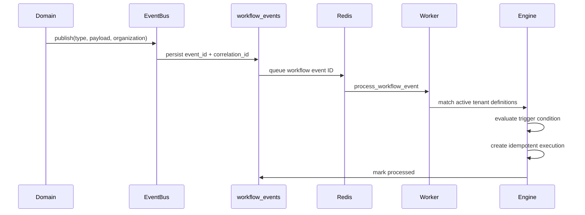

# Workflow Engine 2.0

## Purpose

Workflow Engine 2.0 runs organization-authored automation graphs in response to durable domain events. It extends the configurable graph executor in `app/workflow_engine`; it does not replace the claim lifecycle state machine in `app/workflows`.

## Ownership and tenancy

- `workflow_definitions` and `workflow_executions` are directly tenant-owned and require `organization_id`.
- `workflow_steps` are parent-scoped through `workflow_definitions`.
- `workflow_step_executions` are parent-scoped through `workflow_executions`.
- `workflow_events` are directly tenant-owned durable inbox records.
- API, repository, event matching, execution history, and task processing derive organization scope from authenticated or persisted context. Client-supplied organization identifiers are not accepted.

## Event flow

The event is committed before broker dispatch. A Celery Beat sweep requeues pending inbox rows every minute, so a Redis outage does not discard accepted events. Processing retries three times with exponential backoff, then marks the inbox row `dead_letter` with its last error.

A unique `(organization_id, event_id)` inbox constraint prevents duplicate ingestion. A unique `(workflow_id, trigger_event_id)` execution constraint prevents duplicate workflow runs for replayed events.

## Supported triggers

- `claim.created`, `claim.imported`, `claim.analyzed`
- `appeal.generated`, `appeal.approved`
- `submission.created`, `submission.failed`
- `payment.received`, `payment.verified`
- `invoice.generated`

Trigger conditions use the safe condition grammar documented in `app/workflow_engine/conditions.py`. Event fields are available under `event.*`; a tenant-scoped claim snapshot is available under `claim.*` when `claim_id` is present.

## Actions and controls

Built-in plugin actions are registered in `app/workflows/actions.py`. Graph controls include condition, wait, human approval, and end. Unknown or unimplemented actions are rejected before persistence.

Workflows may generate an appeal and pause for human approval. They cannot submit an appeal. Submission remains a separate authenticated human action, as required by ADR 0002. Event publication that would represent automatic submission is rejected.

## API

All routes require authentication and the narrowest existing workflow permission.

- `GET/POST /api/v1/workflows`
- `PUT/DELETE /api/v1/workflows/{id}`
- `POST /api/v1/workflows/{id}/enable`
- `POST /api/v1/workflows/{id}/disable`
- `GET /api/v1/workflow-actions`
- `GET /api/v1/workflow-history`
- Existing `/workflow-definitions` and `/workflow-executions` routes remain compatible.

Definitions with execution history cannot be deleted; disable them instead. Definition and graph mutations increment the version and write immutable audit records with actor, before/after values, reason, and correlation ID when supplied.

## Operations

### Health signals

Monitor:

- pending inbox age and count;
- dead-letter count and last error;
- event processing attempts;
- execution status and duration;
- Celery queue depth and Beat liveness.

Alert the platform on-call when a workflow event remains pending for more than five minutes or any dead-letter event appears. The tenant operations owner decides whether to repair configuration and replay or disable the definition.

### Recovery

1. Correct the failed action or definition and disable unsafe definitions.
2. Change a dead-letter inbox row to `pending` only after investigation and approval.
3. Run `tasks.requeue_pending_workflow_events` or wait for the next one-minute sweep.
4. Confirm one execution exists per `(workflow_id, trigger_event_id)` and the inbox row becomes `processed`.

Do not delete workflow execution or step history during recovery.

## Deployment and rollback

1. Back up PostgreSQL.
2. Deploy migration `a9c3e7f2d5b8` before starting the new API, worker, and Beat images.
3. Verify API health, worker task registration, Beat schedule, and the workflow page.
4. Roll back application images before downgrading the migration.

Downgrade is blocked if non-claim executions exist because the prior schema requires `claim_id`. The PostgreSQL `PUBLISH_EVENT` enum value intentionally remains after downgrade; removing enum values in place is unsafe. Pending inbox records are removed by downgrade, so export or drain them before rollback.

## Known limitations

- The in-process EventBus is synchronous; durable acceptance begins in the workflow handler, not in the publisher's originating database transaction.
- Dead-letter replay is an operator procedure; there is no dedicated replay API yet.
- Centralized metrics and alert delivery remain release-plan blockers.
